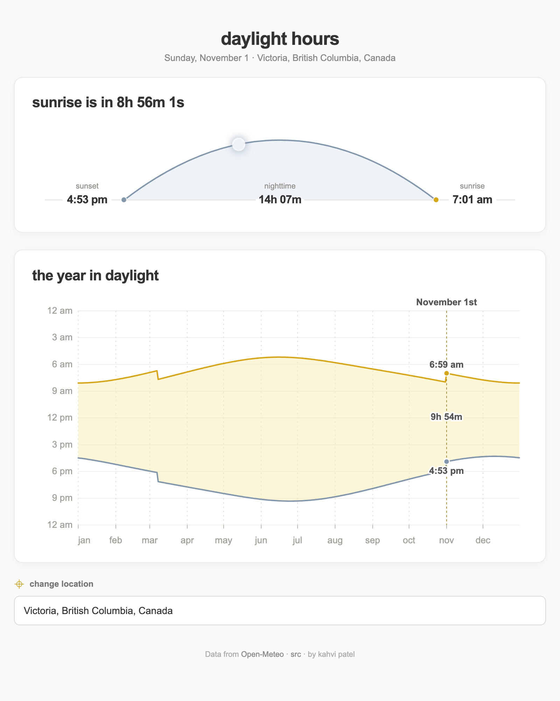

# Daylight hours

This web app shows sunrise, sunset, and daylight duration for a selected location. It also shows a chart for the current year. The times use the time zone of the selected location.



The heading shows the time until the next sunrise or sunset. It uses the clock on your device. The arc widens with the displayed duration, reaching its maximum width at 18 hours; its marker shows elapsed time through the current day or night, not the sun’s actual position. At night, its duration runs from sunset to the next sunrise.

Hover over or touch the yearly chart to show that date’s sunrise, sunset, and daylight duration in the top card. You can also focus the chart and use the arrow keys. The countdown stays on the current day; the card returns to the current day or night when you leave the chart or tap outside it. The elapsed-time marker is hidden while exploring the chart.

Search for a city to select a location. The URL then includes the location parameters `lat`, `lon`, `tz`, and `n`. You can share this URL.

## Start the app

1. Start a static web server in the project directory. For example:

   ```sh
   python3 -m http.server 8000
   ```

2. Optionally copy `config.example.js` to `config.js` and set `weatherApiKey` to a [WeatherAPI.com](https://www.weatherapi.com/) API key. `config.js` is gitignored. Without a key, the app skips WeatherAPI and uses local solar calculations if Open-Meteo fails.

3. Open <http://localhost:8000> in a browser.

This is a static app: the WeatherAPI key in `config.js` is visible to every visitor. Deploy that file with the site to enable the WeatherAPI fallback; use a server-side proxy if the key must remain secret.

## Data

Open-Meteo supplies yesterday, today and tomorrow from its forecast API and the current year from its climate API. If the forecast fails, the app tries WeatherAPI.com’s astronomy API, then local [SunCalc](https://github.com/mourner/suncalc) calculations. If the climate API fails, SunCalc calculates the year locally, avoiding one WeatherAPI request per day. City search still uses Open-Meteo geocoding.

The sunrise and sunset times are astronomical. Clouds do not change these times. Providers use different locations and algorithms, so times can differ slightly. The chart uses the same data as the card for today. Gaps show days without sunrise or sunset.

Provider adapters live in `providers.js`. To add a provider, implement `getDays(start, end, location, signal, kind)` returning one `{ date, sunrise, sunset, duration }` per local date, with event timestamps and duration in seconds; return null events and a duration of 0 or 86400 for polar night or day. Add the adapter to the appropriate ordered fallback list in `load()` in `app.js`. Failed, timed-out or incomplete responses move to the next provider; changing location cancels outstanding requests.

Run the tests with `node --test test/*.test.js`.
